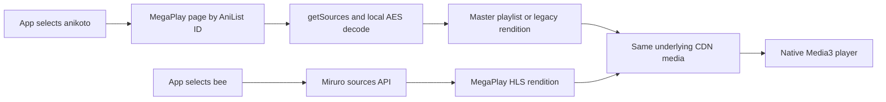

# Anikoto / MegaPlay feasibility investigation — 2026-09-22

Investigated local source at `a85d70bd3a3d`, the supplied ANIKOTO directory and HAR, and live public endpoints. The supplied directory contains captured frontend assets, not Anikoto's backend source; backend behavior was tested through its public responses. The initial investigation below used desktop HTTP observations. The implementation and Android TV validation following the user's approval are recorded at the end of this report.

**Yes: fast native playback is feasible, and both integrations already exist. Miruro's `bee` is an Anikoto route; our separately named `anikoto` provider talks to MegaPlay directly. The useful work is improving those paths, not registering a new upstream provider.**

The strongest evidence is an exact match on the user's episode: Miruro returned the supplied `https://megaplay.buzz/stream/s-2/337825/sub` embed and the HLS rendition in the same directory as the supplied segments. Its episode ID decodes to `anikoto:liar-game-kcq5v:<server-token>`. The native AniList route also resolves to MegaPlay file `179839`.

The compact [evidence snapshot](anikoto-2026-09-22-evidence.json) records input hashes, timings, source responses, header checks, rendition checks and codec results. Full temporary captures are in `build/anikoto-investigation/`.

**How the two paths converge**



This gives independent resolution paths, but not independent video hosting. If Miruro's API fails, direct Anikoto can still work. If their shared CDN is unavailable, both can fail together. Keeping both has value; representing them as unrelated upstream libraries would be misleading.

**What the saved website actually does**

The supplied watch page is Liar Game episode 25. Its site ID is `8717`, AniList ID `197754`, and the live episode list gives MAL ID `62331`. These are distinct from both the real episode ID `337825` and MegaPlay file ID `179839`.

The site route is:

1. `/watch/liar-game-kcq5v/ep-25` identifies the title.
2. `/ajax/episode/list/8717` returns the episode's opaque `data-ids` server token and explicit sub/dub availability.
3. `/ajax/server/list?servers=<token>` returns Vidstream-2 and Vidstream-1 beta.
4. `/ajax/server?get=<link-id>` returns the chosen embed and skip times.
5. The MegaPlay page supplies `data-id="179839"`; `data-realid="337825"` is not the ID passed to getSources.
6. `stream/getSourcesNew?id=179839&id=179839` returns tracks, skip times and an encrypted source URL. The original `stream/getSources` route also remains discoverable in the client.
7. Local AES-256-CBC decoding yields a JSON object with `file`, the master playlist URL. The zero-padded public key and IV in the saved/live client match the existing Kotlin implementation. No browser execution is required for this step.
8. The HLS playlists name media segments on the CDN. All sampled native streams carry ordinary MPEG-TS bytes.

The direct route removes the site's title search, episode HTML, server list and server-link requests. `https://megaplay.buzz/stream/ani/197754/25/sub` returns the same file as the user's `s-2` URL. The app already uses that shortcut, with MAL mapping and site scraping as fallbacks.

Live server resolution distinguished Vidstream-2's `/stream/s-2/...` wrapper from Vidstream-1 beta's `/videojs/stream/s-2/...` wrapper. Miruro returned the same direct HLS URL for both. They are not evidence of two separate encodes or CDNs.

The supplied files have different roles:

| Files | Role and relevance |
| --- | --- |
| `ep-25`, `main.js` | Site identity, episode selection, AJAX/server selection. Avoid these on the normal fast path. |
| `newclient.min.js` | Source-route rewrite, URL-token decoding, conditional segment stripping, proxy/domain and health failover. This contains the meaningful protocol differences. |
| `e1-player.min.js` | Obfuscated player controller with anti-debug code. Not needed to execute for the verified native path. |
| `jw_player.js`, `jwpsrv.js`, `cast_sender.js` | Player/vendor components; do not belong in a native resolver. |
| `handle-bridge.min.js`, fullscreen scripts, `watch-mana.min.js`, `live-sync.min.js` | Browser controls, parent/player communication and watch-state helpers. |
| `mapper.js` | Supplemental servers/downloads keyed by MAL ID, episode and timestamp. The measured response for this episode contained Kiwi download links, not a faster MegaPlay source API. |
| `app.main.js`, `script.js` | Advertising, sandbox-detection and analytics behavior. Not required for extraction. |
| `sw.js` | Empty precache URL list and empty fetch handler; no hidden stream cache providing this speed. |
| `sub-megaplay-buzz` | Saved MegaPlay error page, not a working player response. Do not use it as the successful-playback fixture. |

The saved and live `newclient.min.js?v=4.17` were byte-identical: SHA-256 `9cfb8fe80dbe88802b951a3fc5548c93c63917798a5621c520fb60557a42537c`. Downloaded code was inspected as data; its scripts and document instructions were not executed.

**What was measured**

The Node probe requests the embed, discovers the source route once per run, decodes the source answer and reproduces the app's historical rendition probe. It then fetches the selected playlist and an 8 KiB segment prefix. No cookies, logged-in session or WebView are used.

| Sample | Source URL extracted | After current rendition probe | Through first segment prefix | Result |
| --- | ---: | ---: | ---: | --- |
| Liar Game 25 sub | 112 ms | 297 ms | 668 ms | Valid TS; 3-quality master |
| Frieren 1 sub | 72 ms | 266 ms | 575 ms | Valid TS |
| Frieren 1 dub | 124 ms | 283 ms | 623 ms | Valid TS |
| Bleach 298 sub | 119 ms | 263 ms | 509 ms | Valid TS |
| Bleach 298 dub | 249 ms | 375 ms | 676 ms | Valid TS |
| One Piece 1 sub | 119 ms | 234 ms | 494 ms | Valid TS |
| One Piece 1 dub | 201 ms | 368 ms | 679 ms | Valid TS |
| Solo Leveling 1 sub | 178 ms | 308 ms | 601 ms | Valid TS |
| Solo Leveling 1 dub | 108 ms | 240 ms | 408 ms | Valid TS |

Nine available samples across five titles succeeded. Liar Game episode 25 dub returned no file; the site's episode row explicitly says `data-dub="0"`, so this is an availability result, not an extraction failure. The median across the nine successful samples was 119 ms to extract the source URL, 283 ms including the current rendition probe, and 601 ms through the first segment prefix.

Three repeat runs of the supplied sub episode took 51–109 ms to extract the URL and 149–191 ms including the rendition probe. The first row has a cold *local route cache*, not a proven cold DNS/CDN/server cache: earlier investigation requests had already reached the service.

Miruro's `bee`, tested against the same episode using the existing pipe protocol and `curl_cffi`, returned HTTP 200 in 219, 31 and 32 ms; a second run returned 31, 31 and 16 ms. The catalogue request was 203 ms initially, 109 ms on the second run. `hop` returned 200 in 62 ms in the first run. These are small desktop samples with likely upstream caching, not a universal provider ranking or a promise of equal performance on a TV. Node's plain TLS client was refused by Miruro with 403; the existing browser-impersonating probe client succeeded, so transport shape still matters.

The native timing columns are a protocol subset, not a full replay of every app action. They exclude title metadata/catalogue work, UI scheduling, decoder startup, download preparation and the extra subtitle-offset resolution some dubs need. In this sample set, Bleach, One Piece and Solo Leveling dubs reference the sub encode's subtitle folder; the existing offset logic can therefore add a second sub resolve. Do not remove that correction merely to improve a stopwatch result.

**The HAR proves segment delivery, not startup speed**

The HAR has 74 requests, beginning at 21:53:55 UTC and ending at 22:01:40 UTC. It starts with health polling after the player was already initialized; it does not contain the initial getSources or playlist chain. It records 53 successful segment GETs, all HTTP 200, with a median duration of 50.993 ms. This supports good delivery on that connection but cannot establish how quickly the source initially resolved.

Some exported text-typed media bodies contain UTF-8 replacement bytes and differ in length from their reported binary resource size, even though the HAR stores the export in base64. Live binary probes were used to validate those segments rather than treating those exported bodies as byte-perfect media.

The live `.jpg`, `.html`, `.js` and `.css` segment samples have MPEG-TS synchronization bytes at offsets 0, 188, 376 and 564. They are neither executable script nor HTML documents in substance. `ffprobe` identified the downloaded first segment as **H.264 1920×1080 + AAC**. There is no wrapper to strip on these tested CDN paths and no `#EXT-X-KEY` in the sampled media playlists. This does not establish the format of every alternate backend.

**Headers are load-bearing**

| Resource | No Referer | `Referer: https://megaplay.buzz/` |
| --- | --- | --- |
| Master playlist | 403 | 206 for the bounded range request; ordinary GET 200 |
| JPG/HTML/JS/CSS-named segments | 403 | 200 and valid TS bytes |
| English subtitle | 403 | 206 and WEBVTT content |

These resources returned `Access-Control-Allow-Origin: *`, but CORS does not remove the Referer requirement. Segment servers ignored the small Range request and answered 200; the probe canceled reading after its bounded prefix. The app already carries the MegaPlay Referer in `StreamItem`, and `PlaybackService.configureRequestHeaders` applies it to Media3.

Native playback and local download feasibility are strong. Cast and external-player handoff have a separate header-delivery problem. The existing local proxy handles the external-player case; Cast uses a different route, with existing caveats in `CastStreamRouting.kt`. Neither was device-tested here. Do not advertise this source as header-free.

**A current quality bug is proven**

`AnivexaClient.megaPlayPlayableUrl` probes `index-f1-v1-a1.m3u8` before returning the source. If that sibling exists, it always prefers it over `master.m3u8`. The accompanying comments describe the master's historical 403 response and a single-quality encode.

All nine tested masters now returned 200 with the correct Referer. The old sibling still exists for eight, but it is no longer sufficient to describe all available qualities:

| Sample | Current master | Consequence of selecting the old sibling |
| --- | --- | --- |
| Liar Game 25 sub | 1920×1080, 1280×720, 640×360 via `index-f1/f2/f3.m3u8` | Old sibling 404; app falls back to master, preserving the ladder but paying a wasted request. |
| Bleach 298 sub | 1080p plus working 720p and 480p `index-new-*` renditions | App returns the old 1080p rendition and hides both lower qualities. |
| Bleach 298 dub | 720p plus a working 480p rendition | App returns the old 720p rendition and hides 480p. |
| Frieren, One Piece, Solo Leveling samples | One regular rendition plus an I-frame rendition | The I-frame entry is trick-play metadata, not an additional normal quality. |

All five lower-quality renditions in the first three rows were independently fetched; each media playlist and first segment returned 200 and recognizable TS. The new Liar Game master names 640×360 as “480p”; use its dimensions rather than repeating that incorrect label. Miruro's `bee` currently returns only `index-f1.m3u8` for this episode, so native Anikoto's master path can expose more choice than the pipe response.

A practical fix is to prefer a successfully validated master, retaining the legacy rendition as a conditional fallback if the master fails. Keep the validation result briefly or share the fetched playlist with the playback layer to avoid fetching it twice. Do not simply replace one guessed filename with another, globally force `index-f1.m3u8`, or remove compatibility with the old encoding layout.

**The browser's extra logic and what to port**

The saved client contains capabilities beyond the nine ordinary streams tested:

| Mechanism | Observed behavior | Native implementation guidance |
| --- | --- | --- |
| `SegmentDecrypt` | Decodes `/segment/<base64url-token>` URLs with the public AES format; can rewrite playlists and bootstrap Blob URLs. | Not exercised by these streams. Add a narrowly scoped URL/playlist decoder if a fixture proves this family needs it. Android does not need Blob URLs. |
| `SegmentStrip` | Strips 252 bytes only for specific alternate hosts, including TikTok-related hosts and its configured proxy. | Do not strip every image-typed response: the measured Tyrionx segments begin with valid TS at byte zero. |
| TikTok proxy/failure tracking | Conditional alternate delivery and retries for that host family. | Keep separate from the ordinary Anikoto path; do not run its reachability probes before every normal play. |
| `TrustDomainProxy` | Watch-state reporting and conditional domain rewriting. | Ordinary streams worked without calling its reporting endpoint. Do not fabricate viewing activity or copy telemetry into the app. |
| `CdnHealthFailover` | Fetches `check_domain.json`, polls every 30 s, remembers failed hosts for 5 min, rewrites only hosts marked failed. | Useful resilience gap: add shared, nonblocking health state and rewrite only provider-declared failed hosts. Preserve path/query and request headers. |
| `s` query propagation | The page forwards an existing sanitized `s` selector to getSources. | Preserve selectors when resolving a supplied embed that has one. The supplied/default native path has none. |

The supplied health response means the fallback host is `xdw5v.qeltrix.top`, with **no hosts currently marked failed**. It is not a manifest, source token or instruction to route everything through that hostname. `checked: 15` is the service's reported check count. Hardcoding the fallback would discard the browser's conditional behavior and couple playback to a rotating host. The correct default with `failed: []` is no health-driven rewrite.

**Where app startup can lose seconds**

The source extractor itself was fast in these probes. The watch-screen scheduling has a separate delay:

* `WatchViewModel.kt:65` sets `MIRURO_CATALOG_WAIT_MS = 8_000L`.
* Around lines 467–501, the native fast catalogue and Miruro catalogue start concurrently, but the code awaits Miruro first. It only checks `preferredIsAnivexa` after that wait.
* A selected native Anikoto source can therefore have a ready catalogue while its watch-screen entry still waits for a slow Miruro response or the eight-second bound. This is a code-path finding, not an observed eight-second delay on an attached device.
* `fastAnivexaProviders` already includes `anikoto`; moving it into another label/list cannot eliminate this wait.

The larger speed improvement is to use the selected native provider's ready episode catalogue immediately when it can serve the requested episode and audio, merging Miruro later without changing active playback. Preserve the current Miruro-first policy when the user actually selected a Miruro provider. Test the requested episode/category and cancellation behavior, not merely whether a catalogue contains any rows.

Cold catalogue discovery has its own cost: Anikoto tests episode 1 and the upper bound, and binary-searches when the upper episode is missing. Sub and dub run concurrently, with MAL fallback for missing AniList mappings. Missing mappings and the site's sequential search/episode/server chain are the slow tail. Caching a successful identity and bounded episode/file-ID results can remove repeated mapping work, but cache failures and audio variants independently and invalidate on playback refusal.

**Concrete integration plan**

1. Keep `bee` as the Miruro transport and `anikoto` as the native transport. If clearer names are wanted, use display labels such as “Anikoto via Miruro” and “Anikoto direct” while preserving stored provider IDs, favorites and routing. Do not change `sourceOf("anikoto")` to MIRURO: that sends its `watch/anikoto/...` IDs to an upstream API with a different contract.
2. Fix master selection in `AnivexaClient.kt:1384`, backed by fixtures for the new three-quality layout, old layout, a refused master with working legacy rendition, and both failures. This fixes quality selection as well as redundant work on new encodes.
3. Remove the unrelated Miruro wait for explicitly selected native sources in `WatchViewModel.kt:467`. Verify native-ready/Miruro-slow, Miruro-selected/native-ready, missing requested episode, dub unavailable, navigation cancellation and late catalogue merge.
4. Keep route discovery/decryption and the embed fallback. Add short-lived, single-flight metadata reuse keyed by title/episode/audio only where measurements justify it. The existing route-discovery cache lasts 30 minutes; repeated simultaneous discovery on a cache miss is a separate possible improvement.
5. Port health failover as shared request-layer behavior for this provider. It must cover manifests, segments and subtitles and must not put a health request on the normal startup critical path. Validate fallback hosts and preserve the original host when the health data is missing or ambiguous.
6. Add alternate encrypted-URL or wrapped-segment handling only with real fixtures and ensure any adapter is used consistently by playback, downloads and applicable handoff proxies. Browser-only success does not establish support in those other paths.

Before shipping Android changes, run unit tests and release lint for **mobile and TV**, then test actual Media3 readiness, seek, next episode, subtitle timing, 720p/480p selection, download/export and device handoff where supported. A representative slow TV is important for the catalogue-order change.

**Limits and deliverables**

No Android device was connected during the initial investigation. That phase had no on-device first-frame measurement, sustained whole-episode/download verification or Cast test. See the follow-up below for subsequent TV emulator tests. Five titles and a single desktop/network cannot establish catalogue-wide or regional reliability. The AES constants and hostname behavior are current observations of an externally controlled service.

The initial graphify CLI could not start on this machine. Its existing graph was inspected via the documented JSON fallback, but it did not cover the current Anikoto resolver sufficiently; the findings above come from direct source inspection and live evidence, not inferred graph edges.

Added reproducible probes:

```powershell
node tools/investigate-anikoto.mjs
scripts/.venv/Scripts/python.exe tools/investigate-anikoto-miruro.py
```

The Node probe uses only built-in modules and bounded reads. The Miruro comparison uses the repository's existing `curl_cffi` environment. Both perform read-only requests. Syntax and live execution were checked. The initial investigation did not change app source or publish anything.

**Implementation follow-up: TV playback and source loading**

After the user authorized implementation and identified TV as the priority, the shared Android code was updated:

* A selected native provider can use its ready catalogue before Miruro answers, provided the requested episode and audio are present. Miruro selections retain their priority. Outstanding Miruro results merge after the initial catalogue is installed, preserving the selected stream.
* The small native catalogue lookup is no longer cancelled after Miruro succeeds. Anikoto and AniBD can appear without waiting for the full scraper fan-out. This also works on long TV series whose supplemental catalogue remains deferred.
* MegaPlay validates the master first and preserves its quality ladder. The legacy sibling is validated only after master failure; two failures leave the existing embed fallback. Validation scans lines until the first playable URI without allocating a list of the entire playlist.
* MegaPlay CDN health refresh runs asynchronously, with a shared 30-second single-flight limit and five-minute failed-host expiry. Only provider-declared failed hosts are rewritten; path, query and headers survive. The playback resolver sits below caches and above either HTTP transport. Native extraction, downloads, subtitles and the local external-player proxy receive the same policy through OkHttp. Remote Cast receivers do not execute this Android policy.
* Stored provider IDs and routing remain separate: `bee` through Miruro, `anikoto` through the native resolver. Both point into the same backend, but either resolver may remain available when the other fails. No new WebView work or segment buffering was added.

The existing TV playback-buffer policy remains in effect. These changes reduce catalogue waiting and retain adaptive choices; they do not lower playback buffer thresholds to claim a faster start.

Validation completed on 2026-09-22:

| Check | Result |
| --- | --- |
| `testMobileReleaseUnitTest` | 1,930 tests, zero failures/errors |
| `testTvReleaseUnitTest` | 1,930 tests, zero failures/errors |
| `lintVitalMobileRelease`, `lintVitalTvRelease` | Passed |
| TV debug app and instrumentation APK builds | Passed |
| `AnikotoTvPlaybackTest` | Passed on `anilili_tv_lowram`, Android 9/API 28, x86, configured 2 GB RAM |
| `AnikotoTvCatalogTest` | Passed on the same TV emulator with Bleach episode 298 and a 366-episode catalogue |

The 23 new JVM cases cover catalogue selection and cancellation, master/legacy failure handling, and conditional CDN rewriting with malformed data and expiry. The live playback test uses the native resolver, production OkHttp health interceptor, the production automatic TV buffer policy, and Media3 rendering to an offscreen surface. It checks subtitle metadata and master qualities, then waits for an actual decoded first frame. It does not run the complete PlaybackService UI/cache/Cronet chain.

| Sample | First extraction in test | Repeat extraction | Player creation to first frame | Master heights / first decoded height |
| --- | ---: | ---: | ---: | --- |
| Bleach 298 sub | 711 ms | 74 ms | 1,273 ms | 1080/720/480; first frame 1080 |
| Liar Game 25 sub | 152 ms | 65 ms | 1,097 ms | 1080/720/360; first frame 720 |

These are component timings, not episode-open-to-first-frame totals. The extraction calls, explicit master read and repeated resolve occur before the rendering measurement, so connections and HTTP cache may be warm. The player requested a 720p maximum; Bleach's initial decoded frame still reported 1080p, so this test does not establish a strict startup resolution cap or sustained adaptive switching.

The separate watch-screen test exercises the real `WatchViewModel` and repository. With `bee` selected, it reached a resolved HLS stream in 1,891 ms and observed native Anikoto in the source options by 1,892 ms without replacing that stream. Diagnostics confirmed `supplemental catalog deferred` and a `fast-native` merge. The subsequent native Anikoto opening resolved in 402 ms and was listed by 403 ms; diagnostics confirmed that the native catalogue beat Miruro. That second run had warmed catalogue/metadata caches. These sequential results are not a controlled speed comparison between the two routes.

The first emulator attempt failed before playback because its restored September 11 clock rejected the current MegaPlay certificate as not yet valid. Synchronizing the emulator to the host clock resolved the failure with normal certificate verification. No TLS bypass was added.

Raw build/test logs and timings are under `build/anikoto-investigation/tv-*`. The TV debug APK is `app/build/outputs/apk/tv/debug/Anilili-debug_tv.apk` and installs alongside the release. At validation time, no version bump, release upload, source push or commit had been performed. The user subsequently requested local commits on 2026-09-23.

Remaining validation limits: no physical Fire TV/Android TV benchmark, sustained whole-episode playback, seek/next-episode stress run, subtitle synchronization audit, download/export round trip, remote Cast test, or live forced CDN outage. The health policy is covered by deterministic unit tests; the live health response had no failed hosts. Cold metadata discovery and network/provider outages can still delay startup, so instant playback cannot be guaranteed.
